# MarketPilot

A multi-tenant marketing workspace for agencies. Each agency gets an isolated workspace to manage
**clients**, store their **brand profile**, build a per-client **knowledge base** that is searched
with hybrid retrieval (RAG), and generate **AI marketing strategies** that cite their sources, on
**the agency's own model** (bring your own key: OpenAI, Anthropic, Ollama or any OpenAI-compatible
endpoint) with per-call cost tracking and a monthly budget.

- Requirements: [`srs/Software Requirements Specification.md`](srs/Software%20Requirements%20Specification.md)
  (the project is delivered in six phases; see [Status and roadmap](#15-status-and-roadmap))
- Stack: FastAPI, PostgreSQL 16 with pgvector, Redis, Celery, Next.js 16, React 19

## Contents

1. [What is built](#1-what-is-built)
2. [Architecture at a glance](#2-architecture-at-a-glance)
3. [Repository layout](#3-repository-layout)
4. [Quick start](#4-quick-start)
5. [Configuration](#5-configuration)
6. [Backend architecture](#6-backend-architecture)
7. [Multi-tenancy, authentication and security](#7-multi-tenancy-authentication-and-security)
8. [Data model](#8-data-model)
9. [Core workflows](#9-core-workflows)
10. [Frontend architecture](#10-frontend-architecture)
11. [API reference](#11-api-reference)
12. [Testing and CI](#12-testing-and-ci)
13. [Retrieval quality (golden questions)](#13-retrieval-quality-golden-questions)
14. [Bring your own model](#14-bring-your-own-model)
15. [Status and roadmap](#15-status-and-roadmap)
16. [Troubleshooting](#16-troubleshooting)

---

## 1. What is built

| Area | What works today |
| --- | --- |
| **Accounts and tenants** | Register an agency, sign in, switch between agencies you belong to, invite teammates by link, three roles (admin, manager, member), member deactivation, a Team screen for members and invites, agency name and white-label branding (logo, color, report footer), immutable audit log |
| **Clients** | Create, edit, archive and restore clients; brand profile (voice, tone, audience, keywords, do and don't rules, sample text) |
| **Knowledge base (RAG)** | Upload PDF, DOCX, TXT or Markdown (up to 10 MB) or paste text; background chunking and embedding tracked as a job with progress, cancellation and retries; `Idempotency-Key` on upload and re-index; duplicate skipping; re-index and delete; hybrid search (vector plus full-text, fused with RRF); the brand profile is indexed automatically |
| **Background jobs** | A `jobs` table with tenant isolation; job status, list and cancel endpoints; live progress over Server-Sent Events, opened with a 60-second single-use stream ticket |
| **AI gateway (BYOM)** | Encrypted connections to OpenAI, Anthropic, Ollama or OpenAI-compatible endpoints; Test button with model listing; per-task routing with fallback; native structured output with schema validation and repair; token streaming and embeddings in the provider adapters; retries and a deadline |
| **Usage, cost and budget** | Every call recorded (tokens, latency, estimated cost); usage dashboard grouped by day, client, task or model; monthly budget with an 80% warning and an optional hard stop; pre-flight cost estimate |
| **Strategy generation** | Monthly strategy per client (summary, objectives with KPIs, channels, risks) grounded in retrieved knowledge, versioned, with the source chunks and the cost shown; figures the model quotes that were not in its input are flagged as warnings |
| **Protection** | Per-user and per-tenant rate limits on strategy generation, uploads, re-index and search; structured JSON logs with request, tenant and job IDs and secret redaction |
| **Onboarding** | A getting-started checklist on the dashboard (add a client, connect a model, generate a strategy) and a working New client button |
| **Quality** | 332 API tests (83% coverage, 80% enforced in CI), 325 web unit tests, 7 Playwright end-to-end tests including WCAG 2.1 A and AA axe scans, database-level isolation tests, a retrieval hit-rate evaluation, a load smoke script, CI on every push |

Not built yet (see the [roadmap](#15-status-and-roadmap)): website audits and crawler, Google
integrations, content generation, calendar, Kanban board, PDF reports, WordPress/Trello/Asana
integrations, password reset, notifications, and tenant data export and deletion.

---

## 2. Architecture at a glance

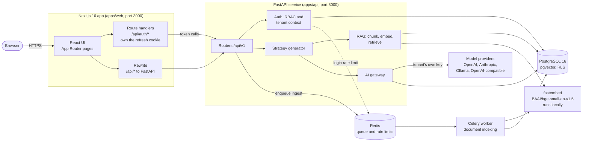

**Design decisions that shape everything else**

| Decision | Why |
| --- | --- |
| **Row-level security in Postgres** with a non-owner database role | Tenant isolation is enforced by the database, not only by application filters. A forgotten `WHERE tenant_id` cannot leak data. |
| **Same-origin proxy** (`/api/*` rewritten to FastAPI) | The browser only talks to the Next.js origin, so the refresh token can live in an `HttpOnly` first-party cookie and CORS is not needed for the UI. |
| **Bring your own model** | The platform carries no AI cost. Keys are encrypted per tenant and calls are made by the API server using the tenant's own connection. |
| **Local embeddings** (fastembed, 384 dimensions) | Indexing and search need no external API or key, so retrieval works the same for every tenant. |
| **Background indexing** (Celery + Redis) | Uploads return immediately; chunking and embedding happen in a worker and are tracked as a job whose progress can be streamed. |
| **Usage rows computed from real calls** | Spend is always summed from `usage_logs`, so the budget can never drift from the data. |

### Technology stack

| Layer | Technology |
| --- | --- |
| API | Python 3.10, FastAPI, SQLAlchemy 2 (async), asyncpg, Alembic, Pydantic v2, PyJWT, argon2-cffi, cryptography (Fernet), httpx |
| Background jobs | Celery 5.5 with Redis as broker and result backend |
| Data | PostgreSQL 16 with the pgvector extension (HNSW cosine index) and a generated `tsvector` column (GIN index) |
| Retrieval | fastembed (`BAAI/bge-small-en-v1.5`), pypdf, python-docx |
| Web | Next.js 16, React 19, TypeScript, Tailwind CSS 4, shadcn/ui on Base UI, TanStack Query, Zustand, react-hook-form with zod |
| Tests | pytest + pytest-asyncio, Vitest + Testing Library, Playwright (Chromium) |
| Tooling | uv, pnpm, ruff, mypy, ESLint, Docker Compose, GitHub Actions |

---

## 3. Repository layout

```text
marketpilot/
├── README.md                  this file
├── docker-compose.yml         postgres (pgvector), redis, celery worker
├── .env.example               every setting the API reads
├── .github/workflows/ci.yml   api, web and e2e jobs
├── srs/                       Software Requirements Specification
├── apps/
│   ├── api/                   FastAPI service
│   │   ├── app/
│   │   │   ├── main.py            app factory, middleware, router registration
│   │   │   ├── config.py          settings from environment / .env
│   │   │   ├── api/v1/            routers: auth, me, members, tenant, clients, knowledge,
│   │   │   │                      strategies, jobs, ai_connections, ai_routes, ai_usage,
│   │   │   │                      ai_budget, audit, health, ready
│   │   │   ├── auth/              JWT, password hashing, RBAC dependencies, login rate
│   │   │   │                      limit, single-use stream tickets
│   │   │   ├── core/              errors (RFC 7807), JSON logging with redaction, request
│   │   │   │                      id middleware, rate limits, audit, crypto, pagination,
│   │   │   │                      redis client
│   │   │   ├── db/                engine, session, RLS context helper, model registry
│   │   │   ├── models/            SQLAlchemy models (one file per table)
│   │   │   ├── ai/                gateway, provider adapters, budget
│   │   │   ├── rag/               chunking, extraction, embeddings, ingestion,
│   │   │   │                      retrieval, auto-managed documents
│   │   │   ├── strategy/          prompt building, generator, output schema, grounding check
│   │   │   └── jobs/              Celery app and tasks, job state and progress publishing
│   │   ├── alembic/versions/      database migrations
│   │   ├── rag_eval/              golden question set and hit-rate script
│   │   ├── scripts/               load_smoke.py (50 users plus 5 concurrent jobs)
│   │   ├── tests/                 API tests; tests/isolation = database-level RLS tests
│   │   └── Dockerfile.worker      worker image
│   └── web/                   Next.js application
│       ├── app/
│       │   ├── (auth)/            login, register, accept-invite
│       │   ├── (app)/             dashboard, clients, clients/[id], settings/ai,
│       │   │                      settings/agency, usage, team
│       │   └── api/auth/*         route handlers that own the refresh cookie
│       ├── components/            feature folders: auth, shell, clients, knowledge,
│       │                          strategy, ai, budget, usage, dashboard, settings, team,
│       │                          ui (shadcn)
│       ├── lib/                   api client, session store, query hooks, schemas, nav
│       └── e2e/                   Playwright tests and a stub LLM server
```

---

## 4. Quick start

Prerequisites: Docker, [uv](https://docs.astral.sh/uv/) (Python 3.10), Node 22 and pnpm 10.

```bash
cp .env.example .env            # then set JWT_SECRET and FERNET_KEYS (command is in the file)
docker compose up -d postgres redis

cd apps/api
uv sync --all-groups
uv run alembic upgrade head
uv run uvicorn app.main:app --port 8000                          # API
uv run celery -A app.jobs.celery_app worker --pool=solo -l info  # document indexing worker

cd ../web
pnpm install
pnpm dev                                                         # http://localhost:3000
```

Then open <http://localhost:3000/register>, create an agency, add a model connection under
**AI models**, create a client, add knowledge documents, and generate a strategy from the client's
**Strategy** tab. Interactive API docs are at <http://localhost:8000/docs>.

The first search or upload downloads the embedding model (about 30 seconds, once).

---

## 5. Configuration

The API reads `.env` from the repository root (or `apps/api`); real environment variables win.

| Variable | Required | Purpose |
| --- | --- | --- |
| `DATABASE_URL` | yes | Runtime connection, as the non-owner `app_user` role (RLS enforced). `postgresql+asyncpg://…` |
| `DATABASE_URL_DIRECT` | yes | Migrations, as the owner role (DDL, grants). `postgresql+psycopg://…` |
| `APP_USER_DB_PASSWORD` | no | Password the migration sets for `app_user`. Change it outside local development. |
| `REDIS_URL` | yes | Celery broker and result backend, rate limits, job progress events and stream tickets |
| `JWT_SECRET` | yes | Signs access tokens (HS256). Use a long random value. |
| `FERNET_KEYS` | yes | Comma-separated Fernet keys. The first encrypts, all decrypt (key rotation). Generate: `python -c "from cryptography.fernet import Fernet; print(Fernet.generate_key().decode())"` |
| `ALLOWED_ORIGINS` | no | CORS origins, default `http://localhost:3000` |
| `ALLOW_PRIVATE_BASE_URLS` | no | `false` by default. Set `true` to let model connections point at loopback or private-network addresses (local Ollama). Link-local and metadata addresses are always refused. |
| `RATE_LIMIT_SCALE` | no | Multiplies every per-user and per-tenant rate limit. Default `1`; leave it alone in production. The test suite raises it. |
| `API_URL` (web) | no | Where Next.js proxies `/api/*`, default `http://localhost:8000/api/v1` |
| `E2E_BASE_URL`, `E2E_DATABASE_URL` | tests | Playwright target and a `psql` URL for seeding (otherwise it uses `docker exec`) |

---

## 6. Backend architecture

### 6.1 Layers

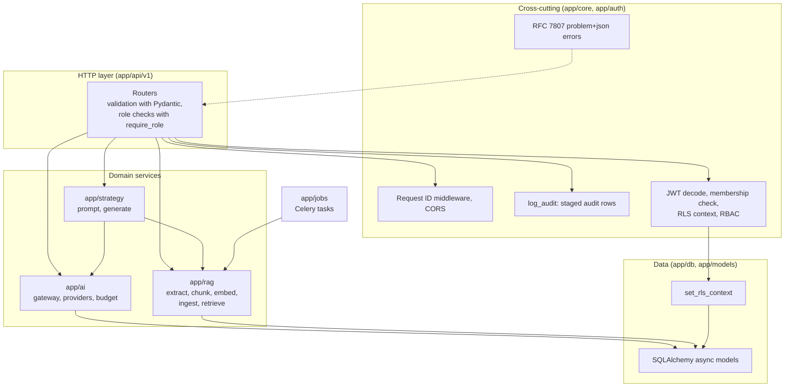

### 6.2 Request lifecycle

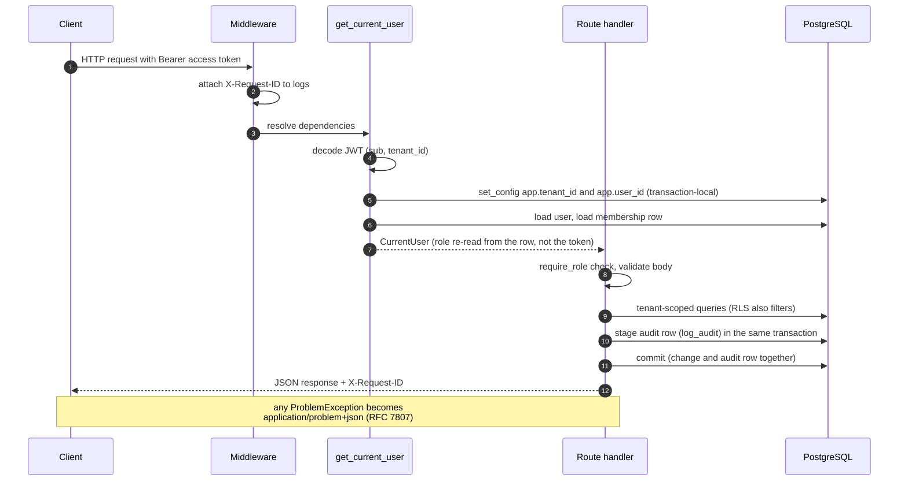

Key behaviours:

- **Role and membership are re-read on every request**, so a role change or deactivation takes
  effect immediately and does not wait for the 15-minute token to expire.
- **Audit rows are staged, not committed separately.** `log_audit` adds the row to the same
  transaction as the change it describes, so the two can never disagree.
- **Errors** are `application/problem+json` with `status`, `title` and `detail`; unhandled
  exceptions return a generic 500 and are logged with the request id.
- **Logging** is structured JSON, with the request id on every line. Secrets are never logged.
- **Pagination** on lists uses opaque keyset cursors (`created_at`, `id`).

---

## 7. Multi-tenancy, authentication and security

### 7.1 Tenant isolation with Postgres RLS

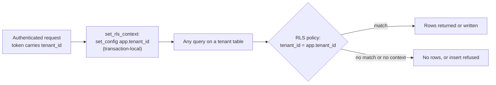

- Every tenant-scoped table has `ENABLE` **and** `FORCE ROW LEVEL SECURITY` and a policy on
  `tenant_id = NULLIF(current_setting('app.tenant_id', true), '')::uuid`.
- The API connects as **`app_user`**, which owns nothing, so it cannot bypass RLS. Migrations
  connect as the owner role.
- The `NULLIF(…, '')` form is deliberate: a pooled connection that has set the variable once
  reports an empty string later, and a bare `::uuid` cast would then error (covered by
  `tests/isolation/test_pooled_connection.py`).
- **Special policies:** `memberships` also allows a row through on `user_id` (so a user can find
  their own memberships before a tenant is chosen); `invites` also allows the exact invite token
  hash (so an invitee who is not a user yet can accept); `audit_log` has only INSERT and SELECT
  policies, so the application role cannot update or delete audit rows.
- Tables without RLS: `users`, `tenants`, `refresh_tokens` (global identity) and `model_pricing`
  (a shared price list).
- Isolation is tested at the database level for every tenant table (`tests/isolation/`): see
  [Testing and CI](#12-testing-and-ci).

### 7.2 Sign-in, token rotation and tenant switching

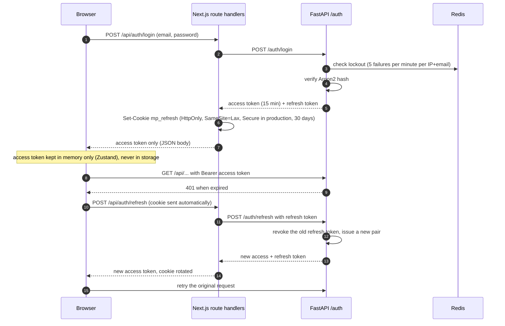

- Refresh tokens are random, stored only as **SHA-256 hashes**, rotated on every use, scoped to
  one tenant, and can be revoked (logout).
- **The last active admin** of an agency cannot be demoted, deactivated or removed, so an agency
  can never be left without an admin.
- **Switch agency** (`POST /auth/switch-tenant`) checks the user's membership in the target
  tenant and issues a fresh token pair scoped to it.
- The web session store holds the access token and `me` in memory; a page reload restores the
  session from the cookie (`SessionGate`).

### 7.3 Invitations

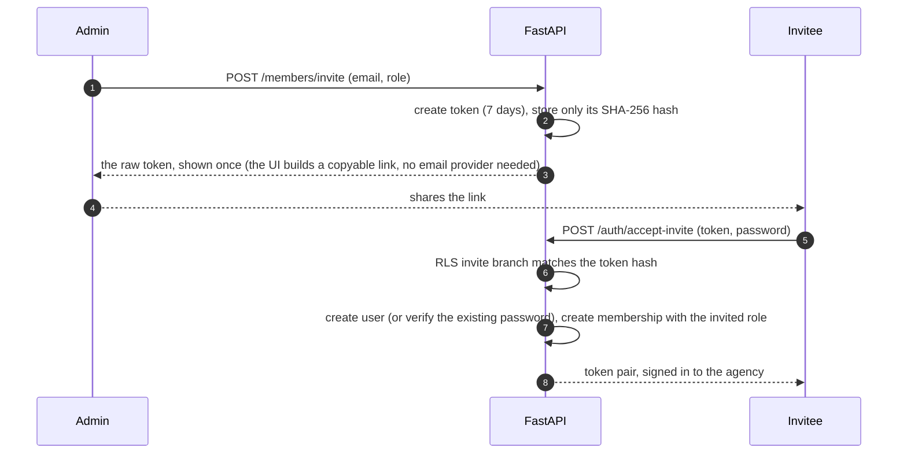

### 7.4 Roles and permissions

Registering creates an agency and makes you its **admin**. Roles are enforced on the server with
`require_role`; the web sidebar mirrors the same rules.

| Capability | admin | manager | member |
| --- | :---: | :---: | :---: |
| View dashboard, clients, brand profiles, documents, strategies, search | yes | yes | yes |
| Create, edit, archive clients; edit brand profile | yes | yes | no |
| Add, re-index, delete knowledge documents | yes | yes | no |
| Generate strategies | yes | yes | no |
| Manage AI connections and per-task routing | yes | yes | no |
| View usage and budget; pre-flight estimate | yes | yes | no |
| Set the monthly budget and hard stop | yes | no | no |
| Manage members and invites; view the audit log | yes | no | no |

### 7.5 Security controls

| Threat | Control |
| --- | --- |
| Cross-tenant access | JWT tenant claim, server RBAC, forced RLS, non-owner role, database-level isolation tests |
| Stolen access token | 15-minute lifetime, kept in memory only |
| Stolen refresh token | `HttpOnly` `SameSite=Lax` cookie set by the Next.js server, hashed at rest, rotated on use, revocable |
| Password storage and brute force | Argon2; login limited to 5 failures per minute per IP and email, then a one-minute lockout (Redis) |
| Provider keys at rest | Fernet encryption (rotatable keys), write-only in the API and UI (only the last 4 characters are shown), never logged |
| SSRF through model base URLs | Only http and https; the host is resolved and checked before every request; link-local and metadata addresses always refused; loopback and private networks refused unless `ALLOW_PRIVATE_BASE_URLS=true`; redirects are not followed |
| Prompt injection through documents | Knowledge text is delimited in `<source>` blocks, labelled as untrusted data, stripped of control characters, and cannot close its own block; the system prompt tells the model not to follow instructions found in sources |
| Abuse of expensive endpoints | Per-user and per-tenant rate limits (Redis, fixed window) on strategy generation, upload, re-index and search return 429 with `Retry-After`; if Redis is down the limiter allows requests rather than blocking them |
| Streams that cannot send an Authorization header | `POST /auth/stream-ticket` issues a 60-second, single-use ticket (stored hashed) that opens an SSE stream for the caller's own tenant only |
| Secrets in logs | Every log line is JSON with request, tenant and job IDs; API keys, bearer tokens, JWTs and password-style values are redacted, including in tracebacks |
| Runaway AI spend | Monthly budget with a hard stop enforced in the gateway (server-side); unpriced models are refused while a hard stop is on |
| Tampering with history | Audit log is append-only for the application role |
| Invalid model output | JSON schema validation with up to two repair retries; nothing is stored if the output never validates |
| Invented figures in a strategy | A post-check flags any figure in the plan's claims that is not in the facts or sources the model was given, and the strategy shows a warning |

---

## 8. Data model

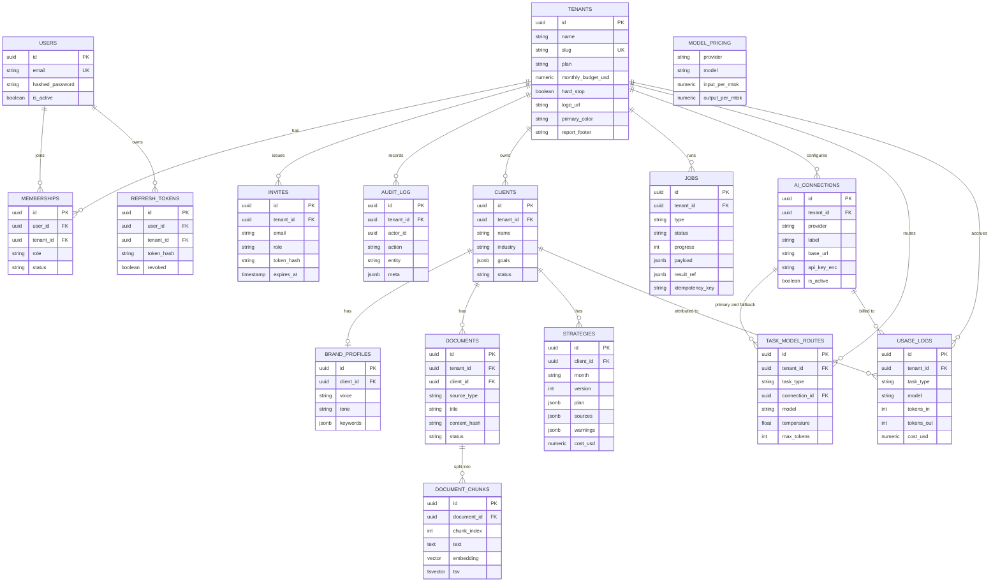

Notes on specific tables:

- **`documents`** are unique per `(client_id, content_hash)`; `status` moves through
  `pending → processing → ready` (or `failed`). `source_type` is `upload`, `brand_doc`,
  `past_content`, or the auto-managed `brand_profile`.
- **`document_chunks`** carry a 384-dimension `vector` (HNSW cosine index) and a generated
  `tsvector` column (GIN index), so one row serves both halves of hybrid search.
- **`strategies`** store a **snapshot** of their sources (chunk id, document title, excerpt), so a
  strategy still shows its sources after a document is deleted. `(client_id, month, version)` is
  unique.
- **`jobs`** track background work (`queued → running → succeeded`, `failed` or `cancelled`). The
  row is the source of truth; every change is also published to a Redis channel scoped to the
  tenant and job, which the SSE endpoint relays. `(tenant_id, idempotency_key)` is unique, so a
  retried POST returns the original job.
- **`strategies.warnings`** lists figures the model quoted that were not in its input.
- **`tenants`** also carry the white-label branding (logo URL, primary color, report footer).
- **`usage_logs.cost_usd`** is `NULL` when no price is known for the model ("unpriced"). Spend is
  always summed from this table.
- **`model_pricing`** is global (USD per million tokens). It is seeded with OpenAI `gpt-4o` and
  `gpt-4o-mini` and 13 Claude models by migrations; Ollama is priced at zero in code.
- 21 Alembic migrations in `apps/api/alembic/versions/` define the schema, the `app_user` role,
  the RLS policies and the seed prices.

---

## 9. Core workflows

### 9.1 Clients and brand profile

Admins and managers create clients (name, website, industry, goals) and fill in a brand profile.
Clients are archived, not deleted (restore any time; generation is blocked while archived). Saving
a brand profile also **creates, updates or removes an auto-managed knowledge document** so the
brand voice is searchable; that document cannot be deleted by hand.

### 9.2 Knowledge base and RAG

**Ingestion (background)**

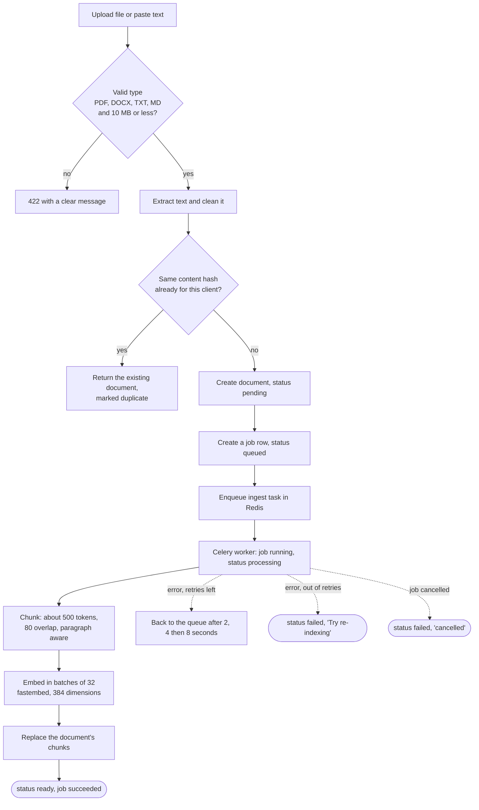

- Every upload and re-index returns a `job_id`. Follow it with `GET /jobs/{id}`, or stream it:
  `POST /auth/stream-ticket`, then open `GET /jobs/{id}/events?ticket=…` (Server-Sent Events:
  the current state first, then each change until the job finishes). `DELETE /jobs/{id}` cancels
  a queued or running job.
- Send an `Idempotency-Key` header (8 to 100 characters) on upload or re-index and a retried
  request returns the original document and job instead of creating another. Reusing a key for
  a different request is a 422.
- If the queue is unavailable the upload is still saved; the job is marked failed and Re-index
  retries it.

- **Re-index** re-runs the same idempotent job; **delete** removes the document and (by cascade)
  its chunks.
- Chunking is boundary-aware: paragraphs are packed whole when possible and oversized ones are
  split on sentence or word boundaries. Tokens are approximated as four characters.

**Retrieval (hybrid search)**

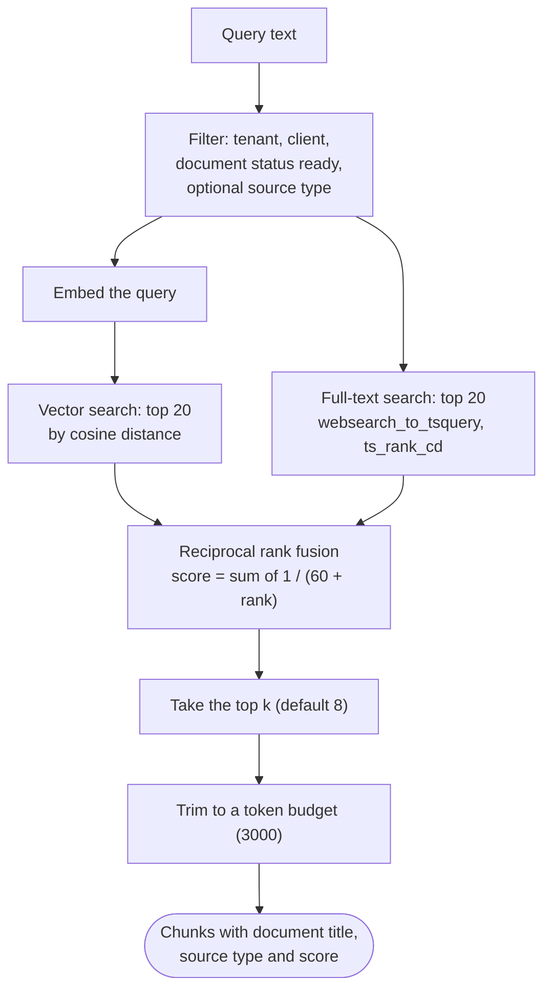

Hybrid search matters because vector search finds paraphrases ("my parcel arrived broken" matches a
shipping-damage policy) while full-text search finds exact terms (product names, figures). The
[golden question evaluation](#13-retrieval-quality-golden-questions) measures how well this works.

### 9.3 The AI gateway

Every model call goes through one function, `ai.gateway.complete`, so routing, budgets, retries,
validation and usage recording behave the same for every feature.

```mermaid
flowchart TD
    start["complete(task, messages, schema)"] --> hs{"Hard stop on and<br/>spend at or over budget?"}
    hs -->|yes| be["402 Monthly AI budget reached"]
    hs -->|no| rt["Load the tenant's route for the task<br/>(primary and optional fallback)"]
    rt --> nr{"Route and active<br/>connection found?"}
    nr -->|no| e409["409 Set up a model in AI models"]
    nr -->|yes| act{"Hard stop active?"}
    act -->|yes| pr{"Target has a known price?"}
    pr -->|no, none left| unp["409 No known price,<br/>hard stop cannot be enforced"]
    pr -->|yes| call
    act -->|no| call["Call the provider adapter<br/>(key decrypted in memory only)"]
    call --> tr{"Transient error<br/>timeout, 429, 5xx?"}
    tr -->|yes, up to 3 attempts| call
    tr -->|exhausted| nxt
    call --> val{"Structured output<br/>valid against the schema?"}
    val -->|no, up to 2 repair retries<br/>with feedback| call
    val -->|still invalid| waste["Record the wasted tokens"]
    waste --> nxt
    nxt{"Fallback target<br/>left?"} -->|yes| call
    nxt -->|no| e502["502 with a safe message"]
    val -->|yes| rec["Record usage: tokens, latency, cost<br/>(sum of every attempt)"]
    rec --> done(["Return result"])
    dl["300 second deadline<br/>covers the whole call"] -.-> call
```

**Provider adapters** (`ai/providers.py`)

| Provider | Endpoint | Structured output | Notes |
| --- | --- | --- | --- |
| `openai`, `openai_compatible` | `{base}/chat/completions` | `response_format: json_object` plus the schema in a system message | `openai` defaults to `https://api.openai.com/v1`; compatible endpoints need a base URL |
| `anthropic` | `{base}/v1/messages` | a `respond` tool whose input is the JSON (`tool_choice: auto` plus an instruction, because current models reject a forced tool choice) | `temperature` is omitted for models that reject it and capped at 1.0 for the rest |
| `ollama` | `{base}/api/chat` | native `format` schema | needs a reachable base URL; no key; priced at $0 |

**Pricing and cost.** `cost = (tokens_in × input_price + tokens_out × output_price) / 1,000,000`,
using `model_pricing`. A model with no price gets `cost = NULL` ("unpriced").

**Budget** (`ai/budget.py`, FR-BYOM-05): spend is the sum of this calendar month's (UTC) priced
`usage_logs`; unpriced calls are counted separately and never added.

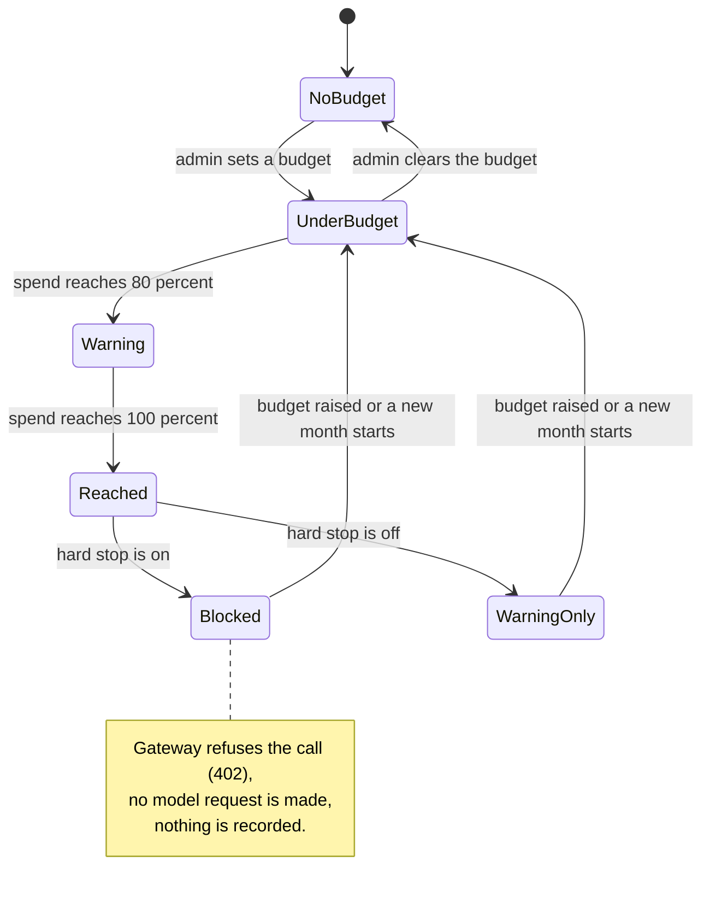

The check happens before the call and the call's own cost is only known afterwards, so the call
that crosses the limit (and any requests already in flight) can overshoot slightly; the next call
is refused. The UI also shows a **pre-flight estimate** (`GET /ai/usage/estimate`): it builds the
real prompt without calling the model and reports estimated input tokens and the maximum cost.

### 9.4 Strategy generation

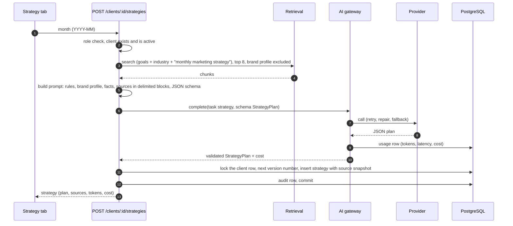

- **Prompt order:** system rules, brand profile, client facts (name, industry, goals, month),
  retrieved chunks as `<source id="…" title="…">` blocks, then the JSON schema.
- **Output** (`StrategyPlan`): `summary`, `objectives[]` (title and KPIs), `channels[]` (name and
  rationale), `risks[]` (risk and mitigation).
- **Versioning:** regenerating creates a new version for that client and month, assigned under a
  row lock so concurrent requests queue instead of colliding.
- **Failure behaviour:** a failed or invalid generation stores nothing; the API returns 402
  (budget), 409 (no route, or unpriced model under a hard stop) or 502 (provider or schema
  failure), and the UI shows the message with a link to **AI models** where relevant.

---

## 10. Frontend architecture

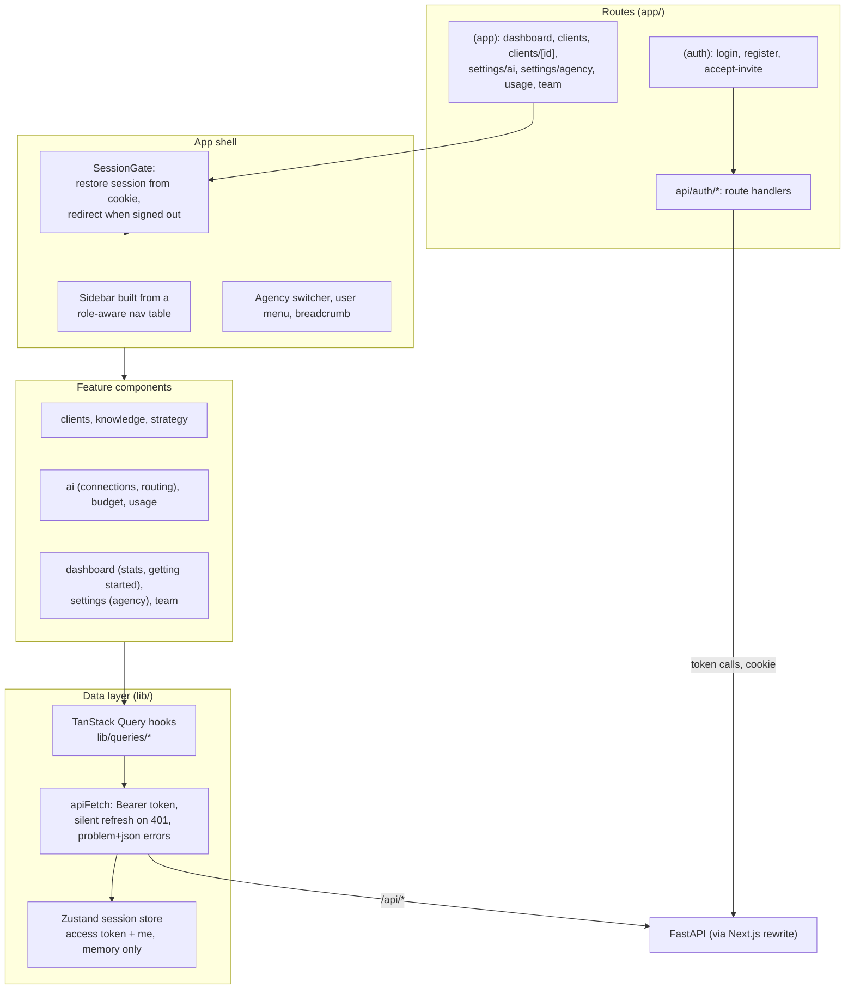

| Concern | Approach |
| --- | --- |
| **Auth flow** | `(auth)` pages post to `/api/auth/*` route handlers, which call FastAPI and store the refresh token in an `HttpOnly` cookie; the browser only ever receives the short-lived access token |
| **Session** | A Zustand store holds the access token and `/me` in memory. `SessionGate` restores it on load and redirects signed-out users to `/login?next=…` (the `next` value is validated by `safe-next`) |
| **API client** | `apiFetch` adds the Bearer token, retries once after a silent refresh on 401 (concurrent refreshes share one request), and turns `problem+json` into typed `ApiError`s |
| **Server state** | TanStack Query hooks per resource (`lib/queries`): clients, brand profile, documents, strategies, AI connections and routes, usage, budget, tenants, members and invites, agency settings |
| **Navigation** | One declarative table in `lib/nav.ts` says which role sees which item; it mirrors the API's role checks |
| **Forms** | react-hook-form with zod schemas; server errors are shown inline |
| **UI** | shadcn/ui on Base UI, Tailwind 4, dark monochrome theme; every clickable shows a pointer cursor |
| **Pages** | Dashboard (getting-started checklist for admins and managers, New client button, role-aware stat strip, recent clients), Clients list, Client page (Overview, Brand profile, Knowledge, Strategy tabs; strategies show grounding warnings), AI models (connections, per-task routing, budget), Usage (summary, daily cost chart, breakdowns), Team (admins: members, roles, invites), Agency (admins: name and white-label branding) |
| **Accessibility** | The Playwright suite scans the sign-in, register and app pages and the New client dialog with axe against WCAG 2.1 A and AA; in-text links are underlined and text meets the contrast ratio |

Job progress is available over SSE (section 9.2), but the web app does not use it yet: the
Knowledge tab still polls document status while anything is pending or processing.

---

## 11. API reference

Base path `/api/v1`. Interactive docs: `/docs` (Swagger UI) and `/openapi.json`. "Any" means any
signed-in member of the agency; roles are listed in [section 7.4](#74-roles-and-permissions).

| Area | Method and path | Who | Purpose |
| --- | --- | --- | --- |
| Health | `GET /health`, `GET /ready` | public | Liveness; readiness checks Postgres and Redis |
| Auth | `POST /auth/register` | public | Create an agency and its first admin |
| | `POST /auth/login` | public | Sign in (rate limited) |
| | `POST /auth/refresh` | refresh token | Rotate the token pair |
| | `POST /auth/logout` | refresh token | Revoke the refresh token |
| | `POST /auth/switch-tenant` | any | Move to another agency you belong to |
| | `POST /auth/accept-invite` | invite token | Join an agency |
| | `POST /auth/stream-ticket` | any | 60-second single-use ticket for opening an SSE stream |
| Me | `GET /me`, `GET /me/tenants` | any | Current identity; agencies you belong to |
| Members | `GET /members`, `PATCH`/`DELETE /members/{id}` | admin | List, change role or status, remove |
| | `POST /members/invite`, `GET /members/invites`, `DELETE /members/invites/{id}` | admin | Create, list, revoke invites |
| Agency | `GET /tenant` | any | Agency name, plan and branding |
| | `PATCH /tenant`, `PUT /tenant/branding` | admin | Rename; set logo URL, primary color, report footer |
| Audit | `GET /audit-log` | admin | Immutable activity log |
| Clients | `GET /clients`, `GET /clients/{id}` | any | List (paginated), read |
| | `POST /clients`, `PATCH /clients/{id}`, `DELETE /clients/{id}` | admin, manager | Create, edit, archive |
| | `GET`/`PUT /clients/{id}/brand-profile` | read: any, write: admin, manager | Brand profile |
| Knowledge | `GET /clients/{id}/documents` | any | List documents |
| | `POST /clients/{id}/documents` | admin, manager | Upload a file (multipart) or paste text (JSON); returns a `job_id`; accepts `Idempotency-Key` |
| | `POST /documents/{id}/reindex`, `DELETE /documents/{id}` | admin, manager | Re-index (returns a `job_id`, accepts `Idempotency-Key`), delete |
| | `POST /clients/{id}/search` | any | Hybrid search |
| Strategies | `POST /clients/{id}/strategies` | admin, manager | Generate a new version |
| | `GET /clients/{id}/strategies`, `GET /strategies/{id}` | any | List, read |
| Jobs | `GET /jobs`, `GET /jobs/{id}` | any | List (paginated, filter by `status` and `type`), read |
| | `DELETE /jobs/{id}` | admin, manager | Cancel a queued or running job |
| | `GET /jobs/{id}/events?ticket=…` | ticket or bearer | Server-Sent Events: current state, then each change until done |
| AI connections | `GET`/`POST /ai/connections`, `POST /ai/connections/{id}/test`, `DELETE /ai/connections/{id}` | admin, manager | Manage connections; Test lists models |
| AI routing | `GET`/`PUT /ai/routes` | admin, manager | Per-task model routing with fallback |
| Usage | `GET /ai/usage?group_by=day\|client\|task\|model&days=30` | admin, manager | Usage and cost analytics |
| Budget | `GET /ai/budget` | admin, manager | Spend and status |
| | `PUT /ai/budget` | admin | Set monthly budget and hard stop |
| | `GET /ai/usage/estimate` | admin, manager | Pre-flight cost estimate |

Errors are RFC 7807 `application/problem+json`: `{ "status", "title", "detail" }`. A 429 from a rate limit also carries a `Retry-After` header.

---

## 12. Testing and CI

| Layer | Tooling | What it covers | Count |
| --- | --- | --- | --- |
| API unit and integration | pytest, real Postgres and Redis, real embeddings | auth, RBAC, tenants and branding, invites, clients, knowledge and retrieval, jobs and SSE, rate limits, AI connections and gateway, provider contracts (streaming and embeddings against recorded responses), budget, strategies and grounding, audit log, logging and redaction, prompt safety, SSRF guard, worker model registration | 332 tests (incl. isolation and eval), 83% coverage |
| Database isolation | pytest as the non-owner role | forced RLS on every tenant table: own rows visible, other tenants' invisible, no-context default deny, cross-tenant insert/update/delete refused, pooled-connection safety | in `tests/isolation/` |
| Static checks | ruff, mypy, ESLint, `tsc` | lint, types | CI gates |
| Web unit | Vitest + Testing Library | components, hooks, schemas, nav rules | 325 tests |
| End to end | Playwright (Chromium) against the full stack and a stub LLM | AI models and usage; budget warning, hard stop and recovery; client section with knowledge; strategy with sources and cost; dashboard checklist and agency settings; WCAG 2.1 A and AA axe scans | 7 tests |
| Load smoke | `apps/api/scripts/load_smoke.py` | 50 concurrent users on read endpoints plus 5 concurrent indexing jobs; p95 target 300 ms | run by hand |
| Retrieval quality | `rag_eval` | hit rate at k on a golden question set | runs inside pytest |

```bash
# API (CI also enforces 80% coverage: add --cov=app)
cd apps/api && uv run ruff check . && uv run mypy app && uv run pytest -q

# Load smoke test against a running API (use a development database)
cd apps/api && uv run python scripts/load_smoke.py --base-url http://localhost:8000/api/v1

# Web
cd apps/web && pnpm lint && pnpm exec tsc --noEmit
cd apps/web && pnpm test            # on a small machine: pnpm exec vitest run --maxWorkers=2

# End to end (needs Postgres, Redis, the API, the worker and a built web app running)
cd apps/web && pnpm build && pnpm start      # in one terminal
cd apps/web && pnpm e2e                       # in another
```

The e2e tests seed usage through SQL (`docker exec` locally, or `psql` when `E2E_DATABASE_URL` is
set) and run the API with `ALLOW_PRIVATE_BASE_URLS=true` because the stub LLM listens on
`127.0.0.1`.

**Continuous integration** (`.github/workflows/ci.yml`) runs on every push to `main` and every
pull request:

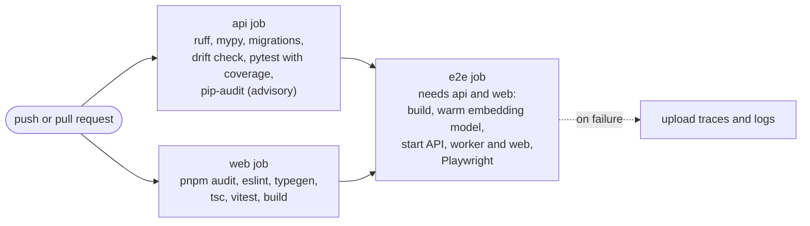

---

## 13. Retrieval quality (golden questions)

`apps/api/rag_eval/` holds a small fixed corpus (8 documents for a fictional coffee roaster) and 18
golden questions, many of them paraphrased so keyword overlap alone does not answer them. The
script indexes the corpus for a throwaway tenant, runs each question through the real hybrid
retrieval (pgvector + full-text, reciprocal rank fusion) and reports **hit rate at k**: the share
of questions whose expected document is among the top k chunks. The tenant is deleted afterwards.

```bash
cd apps/api
uv run python -m rag_eval.run                      # hit@1, hit@3, hit@5 plus every miss
uv run python -m rag_eval.run --k 3 8 --min 0.85   # exit code 1 if hit@8 < 85%
```

It needs Postgres and `.env` like the API, but no worker or LLM key. To extend it, add a `.md`
file to `rag_eval/corpus/` and questions to `rag_eval/golden_questions.json` (`expected` is the
file name). Baseline with `BAAI/bge-small-en-v1.5` embeddings: hit@1 83%, hit@3 100%, hit@5 100%.
`tests/test_rag_eval.py` fails if hit@3 drops below 90%, so a retrieval regression shows up in CI.
The corpus is small and clean, so this guards against regressions; it does not prove quality on
messy real documents.

---

## 14. Bring your own model

Open **AI models**, add a connection (OpenAI, Anthropic, Ollama or any
OpenAI-compatible base URL), press **Test** to list its models, then choose a connection and model
per task (`strategy`, `content`, `analysis`). API keys are encrypted at rest and write-only in the
UI. The monthly budget is on the same page, and per-call cost and tokens are on **Usage**.

Anthropic prices for the current Claude models are seeded; any model without a price is recorded
as "unpriced", and a hard-stopped budget refuses it because its spend cannot be counted.

### Local models (Ollama)

Model calls are made by the **API server**, not by your browser. So the URL you give an Ollama
connection must be reachable *from the machine the API runs on*. `http://localhost:11434` on your
laptop is not reachable from a cloud-hosted API.

Pick one of two setups:

**A. Run the API locally (simplest).** Start Ollama (`ollama serve`, default
`http://localhost:11434`), pull a model (`ollama pull llama3.1`), run the API as in the quick start
and add an Ollama connection with Base URL `http://localhost:11434`. If the API itself runs in a
container, use `http://host.docker.internal:11434` instead. The API refuses loopback and
private-network base URLs by default (so a tenant cannot point it at internal services), so set
`ALLOW_PRIVATE_BASE_URLS=true` in `.env` for this setup. Link-local and cloud-metadata addresses
(`169.254.x.x`) are refused even then.

**B. Use a cloud-hosted API with a tunnel.** Expose Ollama through a tunnel and use the public URL
as the Base URL:

```bash
# Cloudflare Tunnel
cloudflared tunnel --url http://localhost:11434
# or ngrok (Ollama checks the Host header)
ngrok http 11434 --host-header="localhost:11434"
```

Paste the printed `https://…` address into **Base URL**. Ollama has no authentication of its own, so
anyone who has the tunnel URL can use your model. Treat the URL as a secret, put the tunnel behind
access control where your provider supports it, and stop it when you are done. Quick tunnel URLs
change on every restart, so update the connection when that happens.

Notes:

- No API key is needed for Ollama; the key field is hidden for that provider.
- **Test** calls `GET {base}/api/tags`; if it fails, the error is shown on the connection.
- Structured output (strategy JSON) uses Ollama's native `format` schema, so pick a model that
  follows JSON instructions reliably. Small models may fail schema validation more often.
- Local models cost nothing: Ollama calls are recorded at $0.00, so they appear in the usage
  dashboard (tokens and latency) but add nothing to the monthly budget.

---

## 15. Status and roadmap

The SRS delivers the product in six phases. Phase 2 (the AI core) is complete and reviewed.

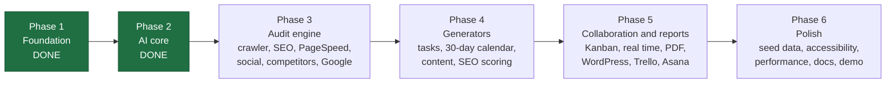

| Phase | Focus | State |
| --- | --- | --- |
| 1. Foundation | Monorepo, Compose stack, auth, tenants, RBAC, RLS, isolation tests, CI | Done (deployment not done) |
| 2. AI core | AI gateway and BYOM UI, RAG ingestion and retrieval, usage tracking | Done: a strategy runs on the user's own key with sources and cost recorded |
| 3. Audit engine | Crawler, SEO checks, PageSpeed, social import, competitors, Google OAuth | Not started |
| 4. Generators | Tasks, 30-day calendar, content, variations, SEO scoring, SSE progress | Not started (the strategy generator was built early as the Phase 2 vertical slice) |
| 5. Collaboration and reports | Kanban, real-time, analytics, PDF reports, WordPress, Trello, Asana | Not started |
| 6. Polish | Seed data, accessibility, performance, docs, pitch | Not started (axe accessibility checks and a load smoke test already exist) |

**Known gaps in what exists**

- Not built: password reset, notifications, and tenant data export and deletion.
- Job progress streams over SSE, but the web app does not consume it yet (the Knowledge tab
  polls), and strategy generation is not a job, so it has no progress stream or idempotency key.
- Rate limits allow requests when Redis is unreachable, by design.
- The project runs on Python 3.10, and the fixed versions of three transitive dependencies
  (`pillow`, `dnspython`, `filelock`) need 3.11 or newer, so CI reports their advisories without
  failing.
- Knowledge currently auto-indexes the brand profile only; audit summaries and approved
  content or strategies will use the same helper (`rag.auto_docs.sync_auto_document`) when those
  features arrive.
- Tenants cannot yet enter their own model prices; models without a seeded price are "unpriced".
- No deployment configuration is included yet (local Docker Compose only).

---

## 16. Troubleshooting

| Symptom | Cause and fix |
| --- | --- |
| API tests or Playwright cannot connect | Postgres or Redis is not running: `docker compose up -d postgres redis` (start Docker Desktop first on Windows) |
| First upload or search is slow | The embedding model downloads once (about 30 s); later runs are fast |
| Documents stay `pending` | The Celery worker is not running, or it is an older copy than the API; start (or restart) it as in the quick start. After pulling changes, restart both the API and the worker, and run `uv run alembic upgrade head` |
| `429 Too Many Requests` with `Retry-After` | A per-user or per-tenant rate limit was hit; wait the number of seconds in the header |
| An SSE stream returns 401 | Stream tickets last 60 seconds and work once; request a new one from `POST /auth/stream-ticket` |
| Test button says private and loopback addresses are not allowed | Expected for `localhost`; set `ALLOW_PRIVATE_BASE_URLS=true` (local use) or use a tunnel |
| "This model has no known price, so the hard stop cannot be enforced" | The model is not in `model_pricing`; turn the hard stop off or use a priced model |
| "Set up a model for the strategy task" (409) | Add a connection and a `strategy` route under **AI models** |
| Vitest times out on a small machine | Run `pnpm exec vitest run --maxWorkers=2` |
| `tsc` cannot find `LayoutProps` on a fresh checkout | Run `pnpm exec next typegen` first |
| Migration says `app_user` role or RLS errors | Apply migrations with `DATABASE_URL_DIRECT` (owner), run the API with `DATABASE_URL` (`app_user`) |
